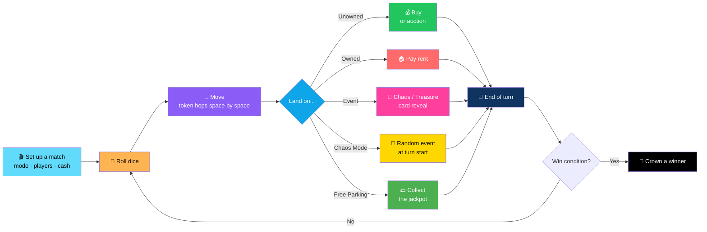
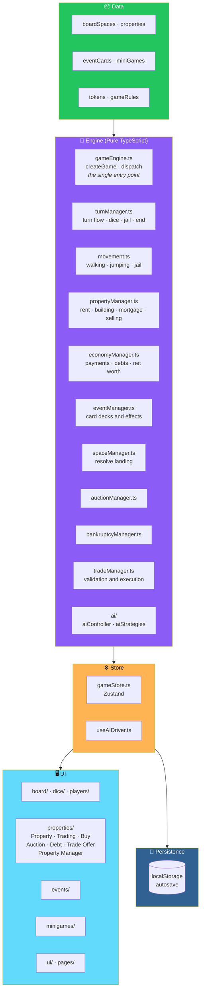

# 🎲 Monopoly Mayhem

<div align="center">


**A colourful, chaotic, property-trading board game for the browser.**

*Buy streets · Build hotels · Trade with cunning AI · Survive banana peels, rent holidays, and surprise auctions*

[🎮 Rules](#-game-rules) • [✨ Features](#-features) • [🏗️ Architecture](#-architecture) • [🧪 Testing](#-testing) • [🚢 Deployment](#-deployment)

</div>

---

## 📖 Overview

**Monopoly Mayhem** is a **colourful, chaotic, property-trading board game** for the browser.

### Core Idea

> **Everything is playable start to finish.**
>
> Set up a match, roll the dice, buy and trade property, get bankrupted by a Hyperloop, and crown a winner.

### The Game Flow



---

## 🖼️ Screenshots

> **Add your own captures to `docs/screenshots/` and link them here.**

<div align="center">

| Main menu | In game | Mobile |
|:---------:|:-------:|:------:|
| `docs/screenshots/menu.png` | `docs/screenshots/game.png` | `docs/screenshots/mobile.png` |

</div>

---

## ✨ Features

<div align="center">

| 🎮 6 Game Modes | 🗺️ 40-Space Board |
|:---:|:---:|
| **Quick Match** *(2–4)* · **Classic** · **Chaos** · **Solo vs AI** · **Local Multiplayer** *(hot-seat, up to 8)* · **Online Multiplayer** *(architecture ready, no fake networking)* | **22 colour-coded streets** · **4 transit lines** · **2 utilities** · taxes · **Chaos and Treasure** spaces · **Jail** · **Free Parking** · **Go To Jail** · **Mini-Game Arcade** |
| **🐾 8 Glossy Tokens** | **🎲 3D Tumbling Dice** |
| Cat · Robot · Penguin · Dinosaur · Astronaut · Duck · Fox · Alien — **tokens hop space by space** | **Doubles · extra rolls · three-doubles-to-jail** |
| **🏠 Full Property Economy** | **🎴 55 Event Cards** |
| Buy · auction · rent *(set bonus, houses, hotels, stations, utilities)* · mortgage · sell · **build evenly** · **bankruptcy with creditor inheritance** | **33 Chaos + 22 Treasure** with **animated reveals** — Pizza Party · Rich Uncle · Bank Error · Broken Elevator · Tax Inspection · Lucky Day · Traffic Jam · **Property Boom** · **Rent Holiday** · **Crazy Auction** · **Body Swap** · **Robin Hood Day** · more |
| **🎯 5 Optional Mini-Games** | **🤖 4 AI Personalities** |
| Dice Duel · Quick Tap · Lucky Wheel · Memory Match · Number Guess | **The Investor** · **The Banker** · **The Aggressive Trader** · **The Lucky Gambler** — they **buy, bid, build, raise cash from debt, propose deals, and judge trade fairness** |
| **🤝 Trading UI** | **📊 Statistics** |
| Cash · properties · jail cards · **any mix** · **fairness hint against AI** · **accept/reject pop-ups for humans** | Games played/won · win % · properties owned · money earned · **biggest rent** · **most expensive property** |
| **💾 Save and Resume** | **🔊 Synthesized Sound** |
| **LocalStorage autosave after every action** · persisted settings and stats | Via **Howler.js** — dice, coins, purchases, rent, events, jail, win and lose jingles, **looping music** · **no audio files** · mute buttons in-game and in Settings |
| **📱 Responsive** | **♿ Accessible** |
| Desktop · tablet · phone | **Keyboard focus styles** · **ARIA labels** · **Reduce Motion switch** |

</div>

---

## 🛠️ Tech Stack

<div align="center">

| Library | Role |
|---------|------|
| **React 18** | UI |
| **TypeScript** | Language |
| **Vite** | Build tool |
| **Tailwind CSS 3** | Styling |
| **Framer Motion** | Animation |
| **Zustand** | State |
| **Howler.js** | Audio |
| **Lucide React** | Icons |
| **Vitest** | Testing |
| **LocalStorage** | Persistence |

</div>

---

## 🚀 Installation

**Requires Node 18+.**

```bash
npm install
```

### 🛠️ Development Commands

<div align="center">

| Command | What It Does |
|---------|--------------|
| **`npm run dev`** | Start the Vite dev server with hot reload |
| **`npm run typecheck`** | TypeScript type check |
| **`npm test`** | Run the unit test suite once |
| **`npm run build`** | Type check and create a production build in `dist/` |
| **`npm run preview`** | Serve the production build locally |

</div>

### 📦 Build

```bash
npm run build
```

**The static site is written to `dist/`.**

---

## 🎮 Game Rules

### 1. 💵 Starting Cash

**Every player starts with the chosen cash:**

- **Quick: $1,000**
- **Standard / Long: $1,500** *(default — configurable)*

### 2. 🎲 Your Turn

**Roll two dice and move.**

> 💡 **Passing or landing on Start pays a $200 salary.**

### 3. 🏠 Unowned Property

**Buy it at list price** — or **decline and it goes to auction** *(bids in $10 steps, bidders drop out by passing)*.

### 4. 💰 Rent

<div align="center">

| Property Type | Rent |
|:-------------:|------|
| **Complete colour set** | **Base rent doubles** |
| **1–4 houses + hotel** | **Uses the street's rent table** |
| **Stations** | **$25 / $50 / $100 / $200 for 1–4 owned** |
| **Utilities** | **4× dice total (one)** · **10× dice total (both)** |
| **Mortgaged properties** | **Collect nothing** |

</div>

### 5. 🏗️ Building

- **Requires a complete, unmortgaged colour set**
- **Must be even across the set**
- **Buildings sell back at half price**

### 6. 💸 Mortgage

- **Mortgage for half the price**
- **Unmortgage costs +10%**
- **You can also sell an unbuilt property to the bank for half its price**

### 7. 🎲 Doubles

- **Roll again**
- **Three doubles in a row goes to Jail**

### 8. 🔒 Jail

**Three ways out:**

- **Roll doubles**
- **Pay $50**
- **Use a Get Out of Jail Free card**

> 💡 **After three failed rolls you pay the fine and move.**

### 9. 🅿️ Taxes and Fines

**Feed the Free Parking jackpot** *(optional)* — **landing on Free Parking collects it**.

### 10. 💳 Debt

**If you can't pay:**

- **Raise cash** by mortgaging or selling buildings
- **Or declare bankruptcy**

> 💡 **A single creditor inherits your properties — the bank takes them otherwise.**

### 11. 🏆 Winning

<div align="center">

| Mode | Win Condition |
|:----:|--------------|
| **Quick** | After **15 rounds**, richest wins |
| **Standard** | After **40 rounds**, richest wins |
| **Long** | **Last player standing** |

</div>

> 💡 **Net worth = cash + property price** *(half if mortgaged)* **+ building costs**.
>
> **A hard 400-round cap guards against endless games.**

---

## 🏗️ Architecture

### System Overview



### 🎯 The Single Entry Point

> **All state changes go through one function:**

```ts
dispatch(state: GameState, action: GameAction): { state: GameState; error: string | null }
```

### 🔒 Guarantees

<div align="center">

| Guarantee | Implementation |
|-----------|---------------|
| **🚫 Never mutates input** | Returns a new state or an error |
| **❌ Rejects illegal actions** | With a **human-readable message** |
| **🌱 Seeded PRNG in state** | **Games are reproducible** |
| **📦 JSON-serialisable** | **Saving is trivial** |
| **🌐 Online-ready** | **Online play is a matter of running `dispatch` on a server and syncing actions** |

</div>

### 🧩 Separation of Concerns

> **The UI reads state from a Zustand store, which only adds presentation concerns:**

- Dice tumbling delay
- Token-walk timing
- Toasts
- Sounds
- Autosave

> **`useAIDriver` asks `decideAIAction(state)` what the computer wants to do** — **and dispatches it after a short delay**.

### Design Principles

<div align="center">

| Principle | Implementation |
|-----------|---------------|
| **🧠 Engine is pure** | `src/engine/` has **no React and no browser imports** — everything is testable in Node |
| **🎯 One function, all state changes** | **`dispatch`** is the single entry point — **saving, testing, and online play all depend on it** |
| **🌱 Reproducible games** | **The seeded PRNG lives in the state** — **the same seed produces the same game** |
| **🚫 No fake networking** | **Online is marked "coming soon"** — **the architecture is ready, but nothing pretends it works** |
| **🎭 AI plays by the same rules** | AI actions go through **`dispatch`** like any human action |
| **💾 Autosave every action** | **LocalStorage** saves after every dispatch |
| **📦 Data-driven board and cards** | Board spaces, properties, event cards, mini-games, tokens, and rules live in **`src/data/`** |
| **♿ Accessibility built in** | **Keyboard focus styles** · **ARIA labels** · **Reduce Motion switch** |

</div>

### 📂 Project Structure

```
src/
├── assets/               Notes on generated assets
│                         (sound is synthesised at runtime)
│
├── components/
│   ├── board/            GameBoard · BoardTile · PlayerToken
│   │                     (+ TokenAvatar)
│   ├── dice/             Dice (3D cube) · DiceRoller
│   ├── players/          PlayerCard · PlayerSelector
│   ├── properties/       PropertyCard · PropertyModal
│   │                     TradingModal · BuyModal
│   │                     AuctionModal · DebtModal
│   │                     TradeOfferModal · PropertyManagerModal
│   ├── events/           EventCard · EventModal
│   ├── minigames/        DiceDuel · QuickTap · LuckyWheel
│   │                     MemoryMatch · NumberGuess
│   │                     MiniGameModal
│   └── ui/               Button · Modal · GameLog
│                         Toast · FxLayer
│                         GameOverModal · Confetti
│
├── engine/
│   ├── gameEngine.ts     createGame · dispatch (single entry point)
│   ├── turnManager.ts    turn flow · dice · jail · game end
│   ├── movement.ts       walking · jumping · jail
│   ├── propertyManager.ts rent · building · mortgage · selling
│   ├── economyManager.ts payments · debts · net worth
│   ├── eventManager.ts   card decks and every card effect
│   ├── spaceManager.ts   resolving the space you land on
│   ├── auctionManager.ts auctions
│   ├── bankruptcyManager.ts
│   ├── tradeManager.ts   trade validation and execution
│   ├── ai/               aiController (decides actions)
│   │                     aiStrategies (personalities)
│   └── __tests__/        Vitest suites
│
├── data/                 boardSpaces · properties · eventCards
│                         miniGames · tokens · gameRules
│
├── store/
│   └── gameStore.ts      Zustand store
│
├── hooks/
│   └── useAIDriver.ts
│
├── pages/                MainMenu · GameSetup · GameScreen
│                         Statistics · HowToPlay · Settings
│
├── utils/                random (seeded PRNG) · sound
│                         storage · stats · format
│
└── types/                All game interfaces
```

---

## 🧪 Testing

```bash
npm test
```

### What the Test Suites Cover

<div align="center">

| Area | Coverage |
|------|:--------:|
| **Board and card data integrity** | ✅ |
| **Setup** | ✅ |
| **Movement and salary** | ✅ |
| **Doubles and jail** | ✅ |
| **Buying** | ✅ |
| **Rent** — sets, houses, stations, utilities, boosts | ✅ |
| **Building and mortgages** | ✅ |
| **Taxes and Free Parking** | ✅ |
| **Debt and bankruptcy** | ✅ |
| **Auctions** | ✅ |
| **Trading** — including AI fairness | ✅ |
| **Turn validation** | ✅ |
| **End-of-game logic** | ✅ |
| **Every one of the 55 cards** under **four different player situations** | ✅ |
| **Complete computer-played games** across modes, player counts, and **30+ seeds** — must always finish with a **valid winner** and **consistent money and property state** | ✅ |

</div>

---

## 🚢 Deployment

> **The build output is a static site, so any static host works.**

<div align="center">

| Host | Steps |
|:----:|-------|
| **Vercel / Netlify / Cloudflare Pages** | Build command `npm run build`, output directory `dist` |
| **GitHub Pages** | Set `base: '/<repo-name>/'` in `vite.config.ts`, run `npm run build`, publish `dist/` |
| **Any server** | Copy `dist/` to the web root |

</div>

---

## 🌐 Preparing for Online Multiplayer

> **Not implemented — no fake networking.**

### To Add It

1. **Keep the authoritative `GameState` on a server that runs `dispatch`**
2. **Send `GameAction`s from clients** — the action carries the acting player's id where needed
3. **Broadcast the new state**
4. **Swap the local store's `act` for a network call**

> 💡 **The architecture is already shaped for this** — **`dispatch` is pure, actions are serialisable, and the state is JSON.**

---

## 🗺️ Roadmap

### ✅ Current

- [x] React 18 + TypeScript + Vite foundation
- [x] Tailwind CSS 3 styling with Framer Motion animations
- [x] Zustand state management with LocalStorage persistence
- [x] **6 game modes** — Quick Match *(2–4)*, Classic, Chaos, Solo vs AI, Local Multiplayer *(hot-seat, up to 8)*, and Online Multiplayer *(architecture ready, no fake networking)*
- [x] **40-space board** with 22 colour-coded streets, 4 transit lines, 2 utilities, taxes, Chaos and Treasure spaces, Jail, Free Parking, Go To Jail, and Mini-Game Arcade
- [x] **8 glossy tokens** — Cat, Robot, Penguin, Dinosaur, Astronaut, Duck, Fox, Alien
- [x] Tokens hop space by space
- [x] **3D tumbling dice** with doubles, extra rolls, and three-doubles-to-jail
- [x] Full property economy — buy, auction, rent, mortgage, sell, build evenly
- [x] Rent rules for colour sets, houses, hotels, stations, and utilities
- [x] Bankruptcy with creditor inheritance
- [x] **55 event cards** — 33 Chaos and 22 Treasure with animated reveals
- [x] **Chaos Mode** random events at the start of turns
- [x] **5 optional mini-games** — Dice Duel, Quick Tap, Lucky Wheel, Memory Match, Number Guess
- [x] **4 AI personalities** — Investor, Banker, Aggressive Trader, Lucky Gambler
- [x] AI raises cash from debt and judges trade fairness
- [x] **Trading UI** for cash, properties, jail cards, and any mix
- [x] Fairness hint against AI and accept/reject pop-ups for humans
- [x] **Statistics** — games played/won, win %, properties owned, money earned, biggest rent, most expensive property
- [x] **Save and resume** with autosave after every action
- [x] Persisted settings and stats
- [x] **Synthesized sound via Howler.js** — dice, coins, purchases, rent, events, jail, win and lose jingles, looping music
- [x] **No audio files** — everything synthesised at runtime
- [x] Mute buttons in-game and in Settings
- [x] Responsive layout for desktop, tablet, and phone
- [x] Keyboard focus styles and ARIA labels
- [x] Reduce Motion switch
- [x] **Single pure `dispatch`** as the only entry point for state changes
- [x] **Seeded PRNG in state** — reproducible games
- [x] JSON-serialisable state for trivial saving and future online play
- [x] AI actions go through `dispatch` like human actions
- [x] Comprehensive Vitest suite including 30+ seeded full-game simulations
- [x] Build output deployable to any static host

### 🔜 Future Ideas

- [ ] **Online multiplayer** — run `dispatch` server-side, sync actions, broadcast state
- [ ] **Additional game modes** — team play, tournaments
- [ ] **Additional board layouts** — beyond the current 40-space board
- [ ] **Additional event cards** — beyond the current 55
- [ ] **Additional mini-games** — beyond the current 5
- [ ] **Additional AI personalities**
- [ ] **Local leaderboards** — win rates and best net worth
- [ ] **Sound pack variants** — synthesized per theme
- [ ] **PWA support** — install and play offline
- [ ] **Localization** — bilingual UI

---

## 🤝 Contributing

Contributions are welcome. Please:

1. Fork the repository
2. **Keep the engine pure** — `src/engine/` must not import React or the DOM
3. **Route every state change through `dispatch`** — no direct mutation, no shortcuts
4. **Keep the PRNG in state** — reproducibility is a feature
5. **Keep the state JSON-serialisable** — saving and future online play depend on it
6. **Keep AI actions routed through `dispatch`** — AI plays by the same rules
7. **Keep content in `src/data/`** — board spaces, cards, mini-games, and rules are data
8. **Add tests for any new rule, card, or AI behavior**
9. **Never fake networking** — the Online mode must remain clearly labeled
10. Submit a Pull Request

### Guidelines

- **Never mutate state directly** — always return a new state
- **Never bypass `dispatch`** — not even for AI
- **Never break save compatibility** without a migration path
- **Never ship an audio file** — sound is synthesised
- **Never present a stub as a feature** — the **Online Multiplayer** label is the standard

---

## 📜 License

MIT — see [LICENSE](LICENSE) for details.

---

## 🙏 Acknowledgments

- **Every board game that's ever ended a friendship over a rent payment** — this one's for you
- **The 30+ seeded test games** — for proving the game always finishes
- **Howler.js** — for making synthesised audio playback reliable

---

<div align="center">

### 🎲 ROLL. BUY. TRADE. BANKRUPT. WIN.

**A colourful, chaotic, property-trading board game for the browser.**

**Playable start to finish. Every rule tested. Every game reproducible.**

<br>

⭐ If Monopoly Mayhem bankrupted you fairly, consider giving it a star.

<br>

[⬆ Back to Top](#-monopoly-mayhem)

</div>
